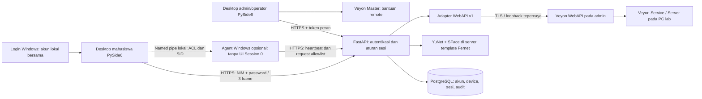
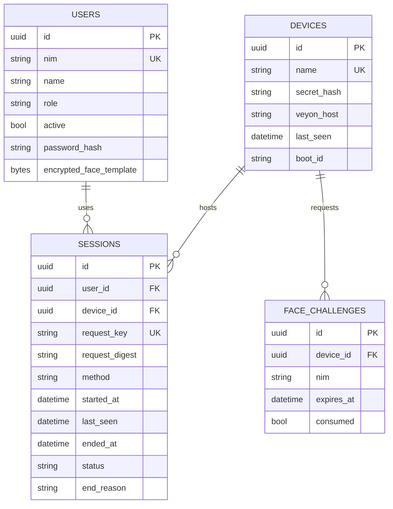

# Arsitektur LabAccess

## Komponen dan batas kepercayaan



Diagram agent menunjukkan jalur opsional. Jalur desktop → HTTPS dan UI melalui
named pipe → API → PostgreSQL telah diuji. SCM LocalSystem belum dibuktikan pada pilot.
Kunci kontrol Veyon hanya di server/admin tepercaya, tidak dikirim ke mahasiswa.

## Model data



Tabel tambahan: enrollment_tokens (hash token, TTL, consumed_at), rate_buckets
(counter atomik per menit) dan audit (pelaku, tindakan, target, alasan; tidak
menyimpan template/frame/token). Dua index unik parsial melarang sesi terbuka
ganda per user/perangkat. Tidak ada endpoint mahasiswa untuk daftar user/audit.

## Alur autentikasi

```mermaid
sequenceDiagram
    participant UI as Desktop mahasiswa
    participant API as FastAPI
    participant DB as PostgreSQL
    participant ADM as Desktop admin
    UI->>API: Credential perangkat + NIM/password + request_key
    API->>DB: Rate limit atomik dan hash Argon2id
    API->>DB: Lock perangkat dan INSERT sesi
    DB-->>API: Constraint unik / sesi yang sama jika retry
    API-->>UI: Token terikat device + waktu server
    loop Setiap 10 detik
        UI->>API: Heartbeat dengan boot_id
        API->>DB: last_seen; deteksi restart
        ADM->>API: Daftar PC/sesi
        API-->>ADM: NIM dari sesi, online/stale dari heartbeat
    end
    UI->>API: Logout + token sesi + credential perangkat
    API->>DB: completed, ended_at, audit
```

Metode wajah mengganti pemeriksaan password dengan tantangan sekali pakai dan
inferensi server; aturan pembukaan sesi tetap sama. Server membandingkan satu
template NIM yang diklaim, bukan mencari mahasiswa pada seluruh database.

## Windows dan agent

Tidak mengganti autentikasi Windows. Login aplikasi tidak mengubah shell,
AppLocker, Assigned Access, firewall atau user Windows. UI bukan security boundary.
Agent menyediakan named pipe dengan ACL SYSTEM/admin + SID akun UI yang dikonfigurasi,
menolak koneksi remote, membaca pesan lalu impersonasi untuk memeriksa SID, serta
allowlist endpoint sesi. UI/kamera tetap di sesi interaktif. Agent tidak memproses
perintah OS atau credential Veyon. Pengujian unit IPC dipisahkan dari validasi SCM.

Server pilot boleh di PC admin. Pemindahan cukup restore database, pemindahan key
secara aman, mengganti hostname/CA TLS serta URL klien. Tidak ada dependency cloud.
